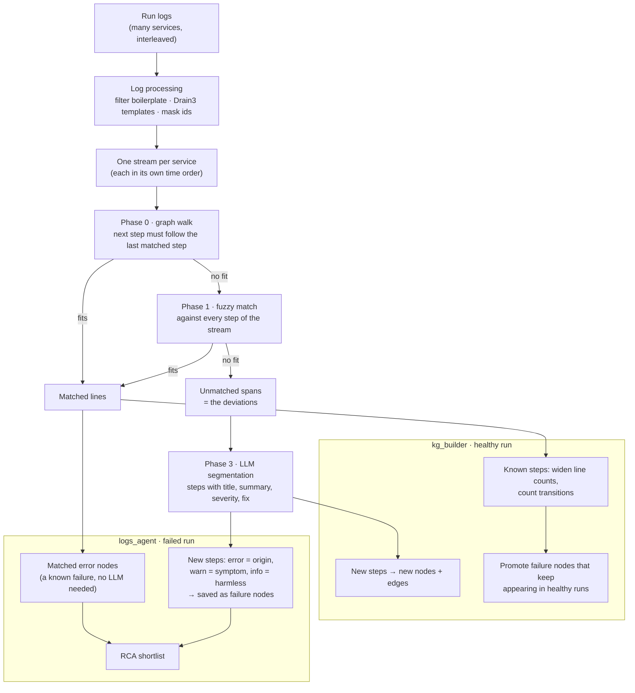
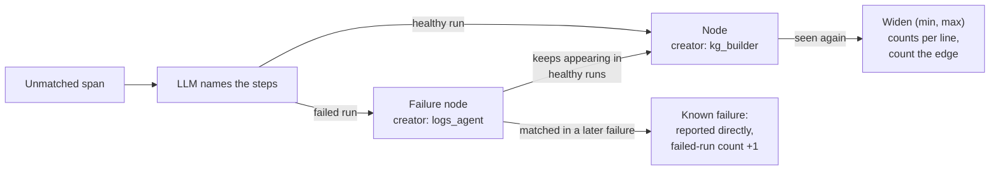

# Clew

> Don't read the logs. Follow the thread.

**Root cause analysis as a diff.** Clew learns the path a healthy workflow takes through its logs, then walks a
failing run along the same path and shows you exactly where it went off it.

It runs locally on the public [OpenStack Fault-Injection dataset](https://github.com/dessertlab/Fault-Injection-Dataset):
the same cloud workload run hundreds of times, each test with one injected bug.

## The idea

A failed workflow produces thousands of log lines from many services, and most of them are perfectly normal.
Searching for `ERROR` finds symptoms, not causes, and misses failures that never log an error.

Clew turns the question around:

1. **Learn what healthy looks like.** From successful runs, build a graph of the steps a workflow takes:
   each node is one logical step (a group of log-line templates), each edge an observed transition.
2. **Walk every new run through the graph.** Lines that fit a known step are normal and are set aside.
3. **What doesn't fit is the deviation.** Only those lines (usually a handful out of thousands) go to an
   LLM, which names the step and grades it: the **origin** of the failure, a **symptom** of it, or harmless.

The graph gets cheaper with every run: the more it has seen, the less is left for the LLM. A failure seen
before is recognised directly, with no LLM call at all.

## How it works

Two agents share one graph:

- **kg_builder** learns from healthy runs: it grows the graph and widens what "normal" means.
- **logs_agent** handles one failed run (an alert): it finds the deviations and produces an RCA shortlist.



The matcher runs cheapest first, and each phase only sees what the previous one could not place. The LLM is
the last resort, and on failed runs it sits behind a token budget: anything over budget stays unmatched
rather than being cut short.

## How the graph grows



- A **node** is one logical step: its distinct line templates, each with a (min, max) repeat count, plus a
  title, summary, severity and fix suggestion from the LLM.
- Its id is the **SHA-256 of its templates**, so the same step resolves to the same node from any run.
- Every node keeps **evidence**: how many healthy runs and how many failed runs it was seen in. A failure
  node is only promoted to "normal" when the healthy side clearly outweighs the failed side.
- Nodes are never deleted; the counts are there to retire them later from data.

## Components

| Folder / file | What it does |
|---|---|
| `ingest/` | Reads the dataset's per-service logs, converts timestamps to UTC, writes one JSONL file per run |
| `processing/` | Log processing: boilerplate filter, Drain3 templating against one shared template store, masking of ids, IPs and timestamps |
| `kg/` | The graph: node model (templates, counts, metadata, evidence), sentinel root and one sub-root per service, edges and transition counts |
| `matcher/` | The walk: Phase 0 (graph traversal), Phase 1 (fuzzy scoring), Phase 3 (LLM segmentation with windowing, retries and a reply cache) and the prompts |
| `storage/` | `NodeRepo`: graph storage as a key-value item store (one JSON file per graph locally, same shape as a DynamoDB table) |
| `kg_builder.py` | Builds and grows the graph from healthy runs; promotes failure nodes on evidence |
| `logs_agent.py` | One failed run → matched error nodes + LLM-explained deviations → RCA shortlist, within a token budget |
| `kg_config.py` | All tunables in one place: graph id, windows, thresholds, budgets |

## Results so far

On the Nova part of the dataset (60 healthy training runs, 20 held-out healthy runs, 33 failed runs):

- **Convergence:** on unseen healthy runs, unmatched lines fell from a median of 138 to 0 as training grew;
  the first run cost about $4 of LLM time, a typical run now costs under $0.02 and half need no LLM call.
- **Root cause:** in 14 of 15 failed runs (silent failures tested separately, below), the shortlist pointed at
  the service where the bug was injected, 8 of them at the exact function, within seconds of the fault firing.
- **Known failures** are recognised from the graph alone: zero LLM calls.
- **Limitation:** failures that leave no wrong line, only missing ones (the run simply stops), show no
  deviation. Origin found in 3 of 16 such "silent" runs.

## Running it

Requires Python 3, AWS credentials with Amazon Bedrock access, and the dataset downloaded into `data/`
(not included: AGPL-3.0, see below).

```bash
pip install -r requirements.txt
export CLEW_LLM_MODEL=<bedrock model id>          # model used for segmentation

python3 ingest/ingest_train.py 100 20              # healthy runs: 100 training + 20 held-out
python processing/build_store.py                   # shared template store from the training runs
python processing/process_runs.py data/logs/splits/nova_train.txt --store

python kg_builder.py create <first_run_id>         # first graph, fully LLM-segmented
python kg_builder.py add <run_id>                  # every later healthy run
python kg_builder.py match <run_id>                # read-only walk, no LLM

python ingest/ingest_run.py Nova Test_89 1         # a failed run (round 1)
echo Nova-Test_89-r1 > case.txt && python processing/process_runs.py case.txt --store
python logs_agent.py Nova-Test_89-r1               # → data/cases/Nova-Test_89-r1.json
```

## Data and licence

Logs come from the OpenStack Fault-Injection dataset by Cotroneo et al.,
*"How Bad Can a Bug Get? An Empirical Analysis of Software Failures in the OpenStack Cloud Computing Platform"*,
ESEC/FSE 2019 ([paper](https://dl.acm.org/doi/10.1145/3338906.3338916),
[logs](https://doi.org/10.6084/m9.figshare.7732268)). The dataset is AGPL-3.0 and is not redistributed here;
ground truth (which bug was injected, and when) is used only to score results, never as an input.
